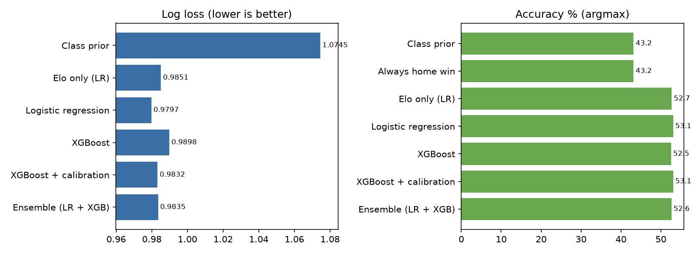

# Premier League Match Outcome Predictor

Predicts **home win / draw / away win probabilities** for Premier League matches from 25 seasons of results
(2000-01 → 2025-26, 9,880 matches), with strict time-based validation and calibrated probabilities.



## Headline results (3 held-out seasons: 2023-24, 2024-25, 2025-26 · 1,140 matches)

| Model | Log loss ↓ | Brier ↓ | Accuracy | ECE ↓ |
|---|---|---|---|---|
| Class prior (always predict base rates) | 1.0745 | 0.6507 | 43.2% | 0.019 |
| Always home win | 1.4051 | 0.8558 | 43.2% | 0.246 |
| Elo only (logistic) | 0.9851 | 0.5880 | 52.7% | 0.023 |
| Logistic regression (39 features) | **0.9797** | 0.5842 | 53.1% | 0.021 |
| XGBoost | 0.9897 | 0.5897 | 52.5% | 0.027 |
| XGBoost + calibration | 0.9835 | 0.5859 | 52.9% | 0.022 |
| **Ensemble (LR + XGB)** — chosen on validation | 0.9834 | 0.5860 | 52.5% | 0.024 |

**Read this honestly**
- All models beat the naive baselines clearly (≈0.09 log-loss better than base rates, ≈+9 pts accuracy).
- A rich feature set + XGBoost adds **very little** over a well-built Elo rating (0.985 → 0.980–0.983). Football
  outcomes are noisy; most of the predictable signal is team strength.
- XGBoost did **not** beat plain logistic regression. With ~9k rows and weak signals, regularised linear models
  are hard to beat. The ensemble was selected on validation seasons only, not on the test set.
- Draws are essentially unpredictable: the model never makes a draw its top pick (recall 0%), though its draw
  probabilities (~20–29%) are reasonable. See `results/figures/draw_probability.png`.
- **No bookmaker comparison.** Odds data was not available in the build environment. Bookmakers typically reach
  log loss of roughly 0.95–0.97 on the PL, so expect them to be better than this model. To add the benchmark,
  download odds from football-data.co.uk, join on date and teams, and compare log loss on the same matches.

## Method

| Step | What | Where |
|---|---|---|
| Data | Season CSVs (results, shots, shots on target, corners) from the open `datasets/football-datasets` GitHub repo | `data/raw/` |
| Features | Elo (goal-diff weighted, home advantage, season regression), rolling form (last 5/10), home/away-specific form, shots/SoT for and against, rest days, season-to-date PPG, promoted flag, head-to-head | `src/features.py` |
| Leakage control | Matches processed chronologically; each feature row uses only pre-kickoff state. Automated test scrambles all post-cutoff results and checks earlier features don't change | `tests/test_no_leakage.py` |
| Validation | Walk-forward: train on all seasons before S, predict S. Tuning on 2020-21…2022-23 only; final report on 2023-24…2025-26 | `src/train.py` |
| Models | Class prior, always-home, Elo-only logistic, logistic regression, XGBoost, calibration (vector scaling fit on validation predictions), LR+XGB ensemble | `src/train.py` |
| Diagnostics | Log loss, Brier, accuracy, ECE, reliability curves, confusion matrix, SHAP importance | `results/` |
| Serving | CLI scoring of any fixture or fixture list, CSV and JSON output | `src/predict.py` |
| Web app | Streamlit: single-match predictor, fixture upload + CSV/JSON/Supabase export, matchup grid, Elo ratings, model performance page | `app/streamlit_app.py` |

Most important features (SHAP): Elo difference and Elo-implied win probability by a wide margin, then
shots-on-target form (10-match difference). Full list in `results/feature_importance.csv`.

## Run it

```bash
pip install -r requirements.txt
python src/train.py                                     # features -> tuning -> eval -> figures -> models/
python tests/test_no_leakage.py                         # leakage test
python src/predict.py --home Arsenal --away Chelsea
python src/predict.py --fixtures fixtures.csv --out predictions.csv   # columns: Date,HomeTeam,AwayTeam
python src/predict.py --ratings                         # current Elo table
streamlit run app/streamlit_app.py                      # web app
```

Team names follow the dataset (`Man City`, `Man United`, `Nott'm Forest`, `Tottenham`...). To refresh data, replace
the CSVs in `data/raw/` with newer ones in the same format and re-run `train.py`.

## Keeping it current
```bash
python src/update_data.py     # downloads the 2026-27 season so far from football-data.co.uk -> data/raw/season-2627.csv
python src/train.py           # retrains (promoted clubs such as Coventry, Hull, Ipswich start at a default Elo)
streamlit run app/streamlit_app.py
```
If the download is blocked, save https://www.football-data.co.uk/mmz4281/2627/E0.csv from your browser and run
`python src/update_data.py --file <saved file>`. Re-run both steps after each matchday.

## Limitations / next steps
- No injuries, line-ups, transfers or xG; adding xG (FBref/Understat) is the most promising upgrade.
- No bookmaker odds benchmark (see above); add it before making any claim about beating the market.
- The 2025-26 season was the hardest of the three test seasons (log loss ≈ 1.03).
- Predictions use data up to the last match in `data/raw/`. Matches played after that, and the current season's
  new promoted teams, need fresh data.
- Ideas: Poisson/Dixon-Coles goal model for scorelines, ordinal model for H<D<A, a Streamlit front end, and a
  weekly GitHub Actions retrain.

## Résumé bullet
*Built a leakage-tested, walk-forward-validated Premier League outcome model (25 seasons, Elo + rolling-form
features, logistic regression/XGBoost ensemble) that improved log loss by about 8.5% over base rates (1.075 → 0.983)
on three held-out seasons, with calibrated probabilities and a CLI for scoring fixtures.*

## Deploy (free)
Push the repo to GitHub, then on share.streamlit.io choose `app/streamlit_app.py`. Keep `models/`, `data/raw/` and `results/`
in the repo. For one-click Supabase export add `SUPABASE_URL` and `SUPABASE_KEY` under the app's Secrets.
